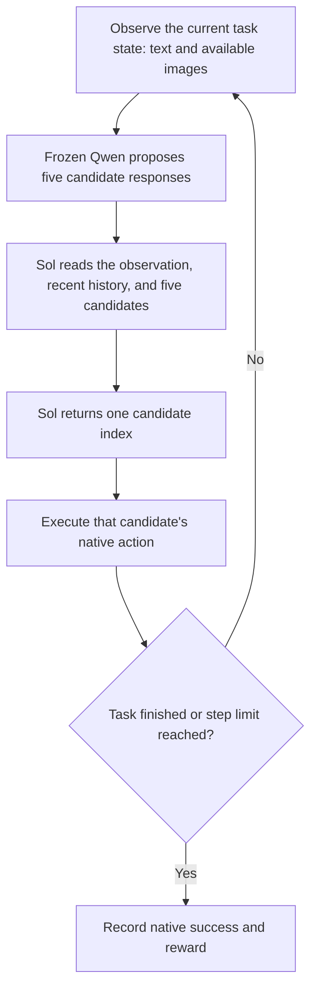

# Can a better action selector make a frozen agent more successful?

This document explains the project from the beginning: the research question, the reference method, what we implemented, the experimental setup, the results, and the next decision. No prior familiarity with action reward models is assumed.

**Current answer:** In the completed pilot, Sol substantially improves Qwen3.5 on text-based ALFWorld: success rises from **46% to 70%** compared with randomly selecting one of five candidate actions. The other five environment–model combinations have positive point estimates, but their uncertainty intervals include or touch zero. We have a promising result in one setting, not yet evidence of reliable improvement across all settings.

**Status (2026-10-14):** The original 1,024-token seed-42 pilot is complete and audited. A separate [1,024-versus-2,048-token diagnostic](runs/v4-sol-nativecmd-output2048-diagnostic10.md) is in progress; its results are not included in the tables below. Seven native episodes have completed, and one WebShop greedy attempt ended in actor context exhaustion. The remaining work has been submitted as Slurm job 361088 after 57 checks passed. Seeds 43 and 44 remain deferred. ARM training and training-data collection remain paused until the task/data choice is settled.

The diagnostic asks whether a larger response allowance improves **Greedy** and changes **Sol-of-five's gain over Greedy**. It uses Qwen3.5-4B, TextWorld and WebShop, the same first 10 reserved pilot tasks in each environment, and seed 42. Both conditions receive the new 2,048-token actor cap; observations, native images, prompts, sampling, context capacity, and step limits stay fixed. It compares against the matching historical 10-task subset. Context-exhausted attempts remain unsuccessful in the fixed denominator and are reported separately from native completed episodes. There is no new Sol-versus-Greedy conclusion yet.

## 1. What are we trying to do?

An interactive agent solves a task by repeatedly observing an environment and taking an action. For example, it might need to find and move an object in a home, or search for and buy a product that meets a shopping request.

A conventional **outcome reward** measures how well the whole attempt ended: did the agent finish the task, or did it buy the right product? An **action reward model (ARM)** instead judges which next action looks more useful at the current state. The motivation is that a model may already be capable of proposing a good action, while still choosing a poor one when generating only one response.

Our research question is: **Can we improve an agent by improving its choice of next action, while keeping the agent's own model weights unchanged?** This is the action-level reward story we want to investigate. Better final task outcomes are the evidence that the choices helped; we are not training a separate outcome reward model in this stage.

The project has two stages:

1. **Establish whether selection helps.** Let the frozen Qwen actor propose five actions, then ask the stronger Sol model to choose one. Compare this with simpler ways of choosing actions.
2. **If the evidence supports it, learn a cheaper selector.** Use teacher preferences to train an ARM, then test whether it preserves useful gains without calling Sol at every step.

The completed experiment covers Stage 1. It does not yet show that a trained ARM improves these benchmarks.

## 2. How does the method work?

Qwen is the model that interacts with the environment. Sol is the stronger OpenAI model used here to judge its proposals. An **actor** proposes actions. A **selector** chooses between those proposals. A **candidate** is one proposed response, including its reasoning and its executable action. An **episode** is one complete attempt at a task.

For the Sol condition, every step follows this loop:

For example, a candidate pool might contain an action that explores another room, one that picks up an object, and several repeated actions. Sol must select an existing candidate; it cannot write a sixth action. If all five candidates propose the same action, the selector has no meaningful choice.

This is **closed-loop evaluation**: the chosen action changes the environment, and subsequent choices use the resulting observations. We do not execute all five alternatives and choose the one with the best observed outcome. Sol receives the visible state and candidate responses, not hidden task solutions or future rewards.

### What Piotr's repository provides

[Piotr Teterwak's `action-reward-models` repository](https://github.com/piotr-teterwak/action-reward-models/tree/4d6dfff869f198f282e4b0e8cf6d429c23dc9fce) is the reference implementation for this project. It provides action-selection prompts, candidate/teacher-label generation code, released artifacts, and two ARM training approaches:

| Approach | What the learned model does | Training target |
|---|---|---|
| **Selection ARM** | Reads the state and all five candidates together, then predicts a candidate index | The teacher's selected index |
| **Scalar ARM** | Assigns a numerical score to each state–candidate pair; the highest score wins | Prefer the teacher-chosen action over rejected actions |

The first learns to imitate a teacher's choice. The second uses a Bradley–Terry preference loss: training encourages the chosen action to receive a higher score than a rejected action. Piotr's scalar-data builder constructs these pairs from the same teacher selections; it keeps up to two eligible rejected candidates whose actions differ from the chosen action. [Selection training recipe](https://github.com/piotr-teterwak/action-reward-models/blob/4d6dfff869f198f282e4b0e8cf6d429c23dc9fce/training/llamafactory/arm_lora.yaml), [scalar training recipe](https://github.com/piotr-teterwak/action-reward-models/blob/4d6dfff869f198f282e4b0e8cf6d429c23dc9fce/training/llamafactory/scalar_rm_lora.yaml), [preference-pair construction](https://github.com/piotr-teterwak/action-reward-models/blob/4d6dfff869f198f282e4b0e8cf6d429c23dc9fce/data_generation/openwebrl_actor/build_scalar_rm_data.py).

The original OpenWebRL teacher-label pipeline uses GPT-5.5; our pilot uses the user-selected Sol model. [Teacher-label builder](https://github.com/piotr-teterwak/action-reward-models/blob/4d6dfff869f198f282e4b0e8cf6d429c23dc9fce/data_generation/openwebrl_actor/build_teacher_batch.py).

Our current pilot replaces the learned selector with Sol directly. It asks whether useful action preferences exist before investing in collecting and training on them.

### What Zixian's implementation provides

[Zixian Ma's `OpenWebRL` ARM branch](https://github.com/zixianma/OpenWebRL/blob/134f064d867170eb833f6ab0f668a1b05050c031/openwebrl/docs/ARM_SUMMARY.md) integrates ARM into the OpenWebRL agent stack and explores three uses:

- **Inference selection:** choose among candidate actions during execution.
- **Offline actor learning:** use preferences to train the actor, through filtered supervised fine-tuning or direct preference optimization.
- **Online reinforcement learning:** incorporate action-level feedback into policy training alongside task outcomes.

This is an integration and extension of the ARM approach, rather than a separate source of our ALFWorld/WebShop results. We use its inference helpers for response splitting, deterministic candidate seeds, prompt assembly, and selection parsing. We do not use its offline actor-training or online RL procedures in this pilot. [Pinned inference implementation](https://github.com/zixianma/OpenWebRL/blob/134f064d867170eb833f6ab0f668a1b05050c031/openwebrl/arm_inference.py).

### What we reused, and what we changed

Our local experiment code directly imports hash-checked copies of Piotr's public prompt builder and Zixian's inference helpers. The selector sees the latest five history entries, candidate reasoning/action pairs, and the current observation. Its requested response is a JSON candidate index. The public prompt flags disable DOM overlays, set-of-marks annotations, vote information, and an explicit explanation in the selector's answer. This does not remove reasoning from the actor's candidate responses. [Public selection prompt](https://github.com/piotr-teterwak/action-reward-models/blob/4d6dfff869f198f282e4b0e8cf6d429c23dc9fce/inference/selection_prompt.py).

The explicit adaptations are the Qwen actors, Sol as the teacher/selector, native benchmark actions, and benchmark-specific observations. We insert native visible text into the public prompt and replace its browser screenshot slot with the images actually provided by the environment. Text-only tasks receive no placeholder image. We do not repair generated actions, remove duplicates, discard truncated candidates, or sample replacements.

Therefore, this is an adaptation of the public ARM selection procedure to new environments and actors. It is not a claim that we reproduced every historical web experiment or recovered an unpublished prompt byte for byte.

## 3. What environments and models did we use?

**ALFWorld** connects language-based household tasks with embodied environments. We evaluate its text environment and its visual THOR environment separately. **WebShop** evaluates shopping agents interacting with a product catalog and following user requirements. See the original benchmark papers: [ALFWorld, ICLR 2021](https://arxiv.org/abs/2010.03768) and [WebShop, NeurIPS 2022](https://arxiv.org/abs/2207.01206).

| Environment | What our agent observes | Actor models | Native outcome and pilot limit |
|---|---|---|---|
| ALFWorld TextWorld | Native text feedback; no images | Qwen3.5-4B and Qwen3-4B-Instruct-2507 | Native task success; 50 decisions |
| ALFWorld THOR | Current RGB camera frame and native text feedback | Qwen3.5-4B and Qwen3-VL-4B-Instruct | Native task success; 50 decisions |
| WebShop | Visible page text, available interface actions, and all current product images, including up to 10 on a search-results page | Qwen3.5-4B and Qwen3-VL-4B-Instruct | Native reward on a 0–1 scale; success means reward = 1; 100 decisions |

All actors have approximately four billion parameters, and their weights remain frozen. The text-only Qwen3 model is used only for TextWorld. Visual tasks use Qwen3-VL or the natively multimodal Qwen3.5, so images are part of the actual model input.

THOR uses the official `mrcnn_astar` perception/navigation controller. Our model selects high-level native commands; the fixed controller carries them out. This measures action selection on top of that controller, not end-to-end learning of low-level visual control. Frames come from the environment's RGB output. ALFWorld admissible-command lists are used for invalid-action diagnostics, not supplied as extra choices to the models.

WebShop uses the full catalog and native search/scoring machinery. The adapter reads visible HTML content and current product/variant images; it does not use hidden goal attributes to formulate search queries. The decision limits above are our fixed pilot limits, not a claim about every benchmark's default horizon.

### Four conditions, with the same task lists

| Condition | How Qwen generates | How the action is chosen | Why include it? |
|---|---|---|---|
| Greedy | One response at temperature 0 | Execute that response's action | Standard deterministic baseline |
| Single sample | One response at temperature 0.7 | Execute that response's action | Separate stochastic generation from selection |
| Random of 5 | Five independent responses at temperature 0.7 | Uniform seeded random selection | Control for proposing five candidates |
| Sol of 5 | Five independent responses at temperature 0.7 | Sol selects an index | Test informed action selection |

Random-of-five is the main comparison for the selection question. It uses the same proposal-count rule, but it does not match Sol's additional computation or API cost. Once policies take different actions, their later observations and candidate pools differ. We therefore do not claim that every choice is compared on identical states, or that this study establishes the best use of a fixed inference budget.

### Tasks, seeds, and smoke reuse

We reserved approximately 10% of the native training data by task/product group, then fixed 50 pilot tasks per environment. Task manifests are shared across both actors and all four conditions within that environment. Official ALFWorld held-out tasks and WebShop test/development tasks are excluded. These are exploratory training-reserve results, not final test-set results.

We first ran the first five tasks of each condition to check complete episodes, image delivery, and selection membership. After those checks passed, we expanded the same manifests to 50. **All 120 completed smoke episodes were reused, including failures, and counted once.** The smoke work was part of the final pilot rather than an extra success-selected sample.

Only execution seed 42 was run: 3 environments (ALFWorld TextWorld, ALFWorld THOR, and WebShop) × 2 actors per environment (Qwen3.5-4B, plus Qwen3-4B-Instruct-2507 for TextWorld or Qwen3-VL-4B-Instruct for THOR/WebShop) × 4 conditions (greedy, single sample, random of 5, and Sol of 5) × 50 tasks = **1,200 complete episodes**. Seeds 43 and 44 were in the original plan but were deferred before execution.

### Generation settings

| Setting | Value in this pilot |
|---|---|
| Selector | `gpt-6.1-sol`, via Chat Completions |
| Selector output limit | 2,048 completion tokens; no temperature, reasoning-effort, or structured-schema override |
| Stochastic candidate generation | 5 independent seeded draws; temperature 0.7; top_p 0.9; top_k disabled (`-1`) |
| Actor response limit | 1,024 tokens, including reasoning where applicable |
| Actor context | 262,144 tokens; causal conversation history |
| Selector history | Last 5 history entries, plus all current candidates and native observation |
| Candidate treatment | Preserve repeated and truncated responses; execute the selected parsed action without semantic repair |
| Malformed selector output | Record a first-candidate fallback; none occurred in this completed pilot |

The 1,024-token limit matters: a response can spend its budget reasoning before producing a useful action. We kept the limit fixed for this version and report its effects below. A different limit would be a new experiment version.

## 4. What happened?

<!-- BEGIN GENERATED: SNAPSHOT -->

Latest audited snapshot: **v3-sol-nativecmd-seed42**, completed **2026-10-06T09:40:38.962824+00:00**. Executed seeds: **[42]**; complete episodes: **1,200**.

<!-- END GENERATED: SNAPSHOT -->

### Task success

<!-- BEGIN GENERATED: SUCCESS -->

| Environment | Actor | Greedy | Single sample | Random of 5 | Sol of 5 | Sol minus random: pp [95% CI] |
|---|---|---:|---:|---:|---:|---:|
| ALFWorld TextWorld | Qwen3.5-4B | 48.0% | 42.0% | 46.0% | 70.0% | +24.0 [+10.0, +38.0] |
| ALFWorld TextWorld | Qwen3-4B-Instruct-2507 | 16.0% | 20.0% | 18.0% | 22.0% | +4.0 [+0.0, +10.0] |
| ALFWorld THOR | Qwen3.5-4B | 14.0% | 10.0% | 8.0% | 18.0% | +10.0 [+0.0, +20.0] |
| ALFWorld THOR | Qwen3-VL-4B-Instruct | 10.0% | 8.0% | 8.0% | 14.0% | +6.0 [+0.0, +14.0] |
| WebShop | Qwen3.5-4B | 18.0% | 22.0% | 22.0% | 28.0% | +6.0 [-4.0, +16.0] |
| WebShop | Qwen3-VL-4B-Instruct | 28.0% | 28.0% | 28.0% | 30.0% | +2.0 [-6.0, +10.0] |

<!-- END GENERATED: SUCCESS -->

The final column is the **absolute difference in percentage points** from random-of-five, with its 95% confidence interval. A rise from 46% to 70% is **+24 percentage points**, meaning 12 additional successes among these 50 tasks. It is not a 24% relative improvement.

**TextWorld × Qwen3.5 is the clearest positive result.** Sol also beats greedy decoding by 22 points and single sampling by 28 points in this setting. Its interval versus random-of-five stays above zero, including in the supplementary analysis that accounts for related task groups.

**The other five settings remain inconclusive relative to random-of-five.** Their point estimates are positive, but their intervals include or touch zero. For example, THOR × Qwen3.5 improves from 8% to 18%, yet its interval is [0, +20] points. That is encouraging but does not justify a broad claim of consistent improvement.

### WebShop's partial-credit reward

Success requires a perfect native reward of 1. The continuous reward also credits partial satisfaction of the shopping request.

<!-- BEGIN GENERATED: REWARD -->

| Actor | Greedy | Single sample | Random of 5 | Sol of 5 | Sol minus random [95% CI] |
|---|---:|---:|---:|---:|---:|
| Qwen3.5-4B | 0.4163 | 0.5577 | 0.5303 | 0.5893 | +0.0590 [-0.0177, +0.1420] |
| Qwen3-VL-4B-Instruct | 0.6156 | 0.6026 | 0.6146 | 0.6542 | +0.0397 [-0.0163, +0.0993] |

<!-- END GENERATED: REWARD -->

Both reward differences are positive estimates, but both intervals include zero. We should report the values and uncertainty together rather than describe WebShop improvement as established.

### What does “95% CI” mean here?

We compare Sol and the baseline **on the same tasks**. Each task contributes a difference: +1 if only Sol succeeds, −1 if only the baseline succeeds, and 0 if their success outcomes agree. We repeatedly resample these task pairs with replacement, compute their mean difference 10,000 times, and take the middle 95% of those values.

For TextWorld × Qwen3.5, both methods succeed on 21 tasks, only Sol succeeds on 14, only random-of-five succeeds on 2, and both fail on 13. The difference is `(14 − 2) / 50 = 0.24`; the resulting interval is **+10 to +38 percentage points**.

This measures uncertainty from the sampled tasks under this bootstrap procedure. It does **not** measure variation across execution seeds—we ran only one—or guarantee that the gain will hold on official test tasks. Intervals are exploratory and not adjusted for multiple comparisons. A supplementary bootstrap resamples whole task groups; TextWorld × Qwen3.5 remains positive, at approximately **+11.5 to +37.0 points**.

### Why might selection help, and what still goes wrong?

| Observation in the recorded trajectories | Why it matters |
|---|---|
| TextWorld × Qwen3.5: selected-response truncation falls from 35.7% with random-of-five to 10.8% with Sol; invalid actions fall from 61.1% to 27.8% | Sol may gain partly by avoiding incomplete or unusable responses. We cannot attribute the whole improvement to deeper planning. |
| THOR × Qwen3.5: all five responses are truncated in 31.4% of the pools visited by Sol | Some states offer no complete candidate, limiting what any selector can choose. |
| All five action strings are identical in 74.6% of Qwen3 TextWorld pools, 92.9% of Qwen3-VL THOR pools, and 71.8% of Qwen3-VL WebShop pools visited by Sol | The selector often has little or no action diversity to exploit. |
| With Sol, 82% of Qwen3.5 THOR episodes and 86% of Qwen3-VL THOR episodes reach the step limit | Visual household tasks remain difficult; candidate generation, perception, navigation, and execution all warrant inspection. |

These are descriptive observations from the states each policy visited. They do not establish a causal explanation or tell us what would have happened if a rejected candidate had been executed.

## 5. What has been implemented and verified?

We cloned and pinned the reference repositories, set up the benchmark and model-serving environments, implemented native observation/action adapters, and built the closed-loop runner, task manifests, resume logic, usage accounting, and paired analysis. Piotr's public prompt builder and Zixian's helpers are imported with source-hash checks rather than independently re-created from a prose description.

The original released inference path and two optimizer steps for each upstream training configuration were also checked earlier. Those were functional installation checks, not full ARM training or a reproduction of all upstream results.

The completed pilot has:

- **1,200 recorded trajectories reconciled with 1,200 result summaries**, with no remaining mismatches.
- **Six environment–actor groups passing the expansion checks**, including native images where required and selected actions belonging to the candidate set.
- **Zero selector parse fallbacks** and **zero unresolved infrastructure errors**.
- Two historical interruptions—a local inference connection error and a Sol HTTP 500 incident—recorded separately. Incomplete episodes were restarted; completed results were preserved and their hashes checked.

This audit checks the consistency of stored trajectories, summaries, and protocol records. It is not an independent replay of every environment transition.

### Upstream limitations we found

“Following the original method” needs a precise boundary because the released materials are not entirely self-contained or consistent:

1. **An old data-generation dependency is missing.** Piotr's OpenWebRL data-generation scripts import `openwebrl.frontier_arbiter`. We did not find that module in the inspected Piotr repository, official OpenWebRL release, or Zixian branch/history. The public prompt builder and Zixian integration provide a usable basis for a new pipeline, but do not prove that the historical private teacher prompt has been recovered. [Example upstream import](https://github.com/piotr-teterwak/action-reward-models/blob/4d6dfff869f198f282e4b0e8cf6d429c23dc9fce/data_generation/openwebrl_actor/build_teacher_batch.py).
2. **The backbone description differs from the artifacts.** The repository's broad Qwen3.5 description should not be used to identify the released OpenWebRL ARM checkpoint. The inspected configuration and training template use `qwen3_vl`. Our Qwen3.5 actor is a separately pinned checkpoint; we do not relabel the older ARM as Qwen3.5. [Released base-model configuration](https://huggingface.co/OpenWebRL/OpenWebRL-4B-SFT/blob/15e777db2ddba2e0e82080ebccd3ad8d215b7f0a/config.json).
3. **Released data and the public inference prompt differ.** Our full audit found that the released selection examples request an explanation before JSON, while their targets are bare JSON; the public no-CoT inference builder requests a JSON-only response. We use the public builder consistently for this pilot and the planned new labeling/training path, rather than silently mixing these prompt variants. This is an observed artifact mismatch, not evidence that the action-selection idea is invalid. [Released selection data at the audited revision](https://huggingface.co/datasets/PTeterwak/action-reward-models-data/tree/13905e69ef10169167eab388533997008694bd6d/openwebrl_actor/selection_sft).

None of these issues blocked the completed inference pilot. Historical private-pipeline equivalence remains unverified; training on newly collected benchmark data remains future work.

## 6. How much did it cost?

<!-- BEGIN GENERATED: COST -->

| Scope | Estimated cost |
|---|---:|
| Sol during the native execution window, including smoke and interrupted attempts (7,294 returned-usage calls) | **$56.80** |
| Sol attributed to complete episodes, including smoke once | $52.19 |
| All recorded Sol calls, including earlier diagnostics | $57.76 |
| Tracked GPU allocation (46.32 H200-hours at $0.90/hour) | $41.69 |

<!-- END GENERATED: COST -->

These are token-usage and resource estimates, not invoices. The API views overlap and must not be added together. GPU accounting includes some earlier diagnostics, so its scope is broader than this seed alone. Charges from calls that never returned usage cannot be fully reconciled from these records.

## 7. What should happen next?

The immediate work is the bounded output-length diagnostic described above. Training-data collection remains paused. The research sequence is:

1. Inspect success/failure cases to distinguish missing good candidates, poor choices among usable candidates, and environment/controller execution problems.
2. Finish the separate 2,048-token diagnostic and compare Sol with Greedy at both output limits. Preserve this pilot as the fixed 1,024-token result; do not expand the diagnostic automatically.
3. Decide which settings justify teacher-label collection and ARM training. Compare a learned selector with both Sol and the same actor baselines; teacher imitation alone is not evidence of improved task success.
4. After the protocol is fixed, evaluate on the official held-out/test splits. Additional execution seeds remain deferred until requested.

The defensible current claim is: **a stronger action selector produces a substantial gain for frozen Qwen3.5 on this TextWorld pilot, while broader generalization and learned-ARM gains remain unproven.**

## Technical appendix: exact versions and implementation details

This appendix is for reproducing or reviewing the setup; the preceding sections contain the complete explanation and research conclusion.

### Pinned sources and checkpoints

| Component | Inspected revision |
|---|---|
| Piotr ARM | [`4d6dfff869f198f282e4b0e8cf6d429c23dc9fce`](https://github.com/piotr-teterwak/action-reward-models/tree/4d6dfff869f198f282e4b0e8cf6d429c23dc9fce) |
| Zixian OpenWebRL ARM | [`134f064d867170eb833f6ab0f668a1b05050c031`](https://github.com/zixianma/OpenWebRL/tree/134f064d867170eb833f6ab0f668a1b05050c031) |
| Official OpenWebRL inspected for dependencies | [`9a120949aca3e58a2628f4b4e6edd0474d984873`](https://github.com/OpenWebRL/OpenWebRL/tree/9a120949aca3e58a2628f4b4e6edd0474d984873) |
| ALFWorld | [`aaba6870f86c5be6a08a491f32a50b906227bc3e`](https://github.com/alfworld/alfworld/tree/aaba6870f86c5be6a08a491f32a50b906227bc3e) |
| WebShop | [`64fa2a5c15c7daa698b9ac93f5bb5437b634c9bd`](https://github.com/princeton-nlp/WebShop/tree/64fa2a5c15c7daa698b9ac93f5bb5437b634c9bd) |
| Qwen3.5-4B | [`851bf6e806efd8d0a36b00ddf55e13ccb7b8cd0a`](https://huggingface.co/Qwen/Qwen3.5-4B/tree/851bf6e806efd8d0a36b00ddf55e13ccb7b8cd0a) |
| Qwen3-4B-Instruct-2507 | [`cdbee75f17c01a7cc42f958dc650907174af0554`](https://huggingface.co/Qwen/Qwen3-4B-Instruct-2507/tree/cdbee75f17c01a7cc42f958dc650907174af0554) |
| Qwen3-VL-4B-Instruct | [`ebb281ec70b05090aa6165b016eac8ec08e71b17`](https://huggingface.co/Qwen/Qwen3-VL-4B-Instruct/tree/ebb281ec70b05090aa6165b016eac8ec08e71b17) |

The Sol identifier is an API alias, not a dated model snapshot. Requested/returned model IDs and call times were recorded. The internal strategy name `gpt5` means “GPT chooses from five candidates”; it does not mean the experiment used GPT-5.

### Runtime

| Component | Recorded configuration |
|---|---|
| Actor serving | vLLM 0.28.0, CUDA 12.9 Apptainer container, H200 GPU, bfloat16, tensor parallelism 1 |
| Serving capacity | Context 262,144; maximum 16 sequences; GPU memory utilization 0.75; normal compilation/CUDA graphs |
| Image processing | Minimum 65,536 and maximum 262,144 pixels; up to 10 images per prompt |
| TextWorld | Python 3.9 environment; TextWorld 1.7.0; official ALFWorld text wrapper |
| THOR | Dedicated environment: AI2-THOR 2.1.0, PyTorch 2.5.1+cu124, torchvision 0.20.1+cu124; Xvfb 640×480×24; official detector/controller |
| WebShop | Dedicated environment: spaCy 3.3.0 with en_core_web_sm 3.3.0, NumPy 1.22.4, Java 11/Lucene; full catalog and search index |
| Experiment identity | Protocol `upstream-public-native-v3`; run tag `v3-sol-nativecmd`; actor prompt `native-alfworld-move-v1` |

The serving version differs from the upstream vLLM 0.26 setup and is recorded as an implementation difference. ALFWorld placement examples use native `move OBJECT to RECEPTACLE` grammar. Earlier runs using legacy placement examples, an earlier context cap, different serving modes, or different teachers are excluded from these results.

### Task reservation and reproducibility

A group enters the pilot reserve when `int(sha256(group_id).hexdigest()[:8], 16) % 10 == 0`. ALFWorld groups related tasks, then uses a deterministic task-type interleaving to select the first 50 eligible tasks. WebShop groups by product ID and selects from training indices ≥1,500; test indices 0–499 and development indices 500–1,499 remain excluded. Manifest ordering uses seed 42. The selected TextWorld tasks contain 41 groups, THOR 42 groups, and WebShop 50 product groups.

WebShop catalog construction uses its fixed seed 233 independently of the execution seed. Candidate draws use deterministic per-task/per-step seeds with Zixian's helper; the wrapper's seed derivation is recorded and is not asserted to be identical to every upstream standalone script.

ALFWorld domain randomization is disabled. A `training_method=dqn` environment flag disables an expert wrapper; it does not mean a DQN actor was trained. Likewise, an internal evaluation-mode flag controls wrapper behavior on explicitly supplied training-reserve paths; it does not turn those paths into held-out tasks.

The frozen result package preserves the original method contract, including its three-seed plan. Its executed-seed fields and final audit correctly identify seed 42 alone. Immutable numerical snapshots are preserved when documentation is updated.

### Optional supporting material

You do not need these files to understand the project. They provide detailed metrics and maintenance instructions:

- [Full seed-42 tables and audit](runs/v3-sol-nativecmd-seed42.md): all baseline differences, all 24 condition rows, candidate diagnostics, confidence intervals, and cost breakdowns.
- [Frozen structured results](data/v3-sol-nativecmd-seed42.json): metrics, protocol, audit, and source-artifact hashes.
- [Decision history](DECISIONS.md) and [update instructions](MAINTENANCE.md).

This GitHub folder contains the report, exported results, and a portable table renderer. The full benchmark/collection/training runtime remains in the separate cluster experiment project; this folder alone is not an end-to-end runnable experiment release.

<!-- BEGIN GENERATED: HISTORY -->

## Experiment history

| Completed (UTC) | Experiment | Executed seeds | Complete episodes | Status |
|---|---|---|---:|---|
| 2026-10-06 | [v3-sol-nativecmd-seed42](runs/v3-sol-nativecmd-seed42.md) | [42] | 1200 | Audited |

<!-- END GENERATED: HISTORY -->
